# El caso del aniversario

Escape room web personal con estética de archivo clasificado. Cinco dossiers, avance por claves de guardado y un cierre por email cuando el caso queda resuelto.

> **Archivo clasificado · Confidencial**  
> *El expediente lleva nueve años abierto. Hoy toca cerrarlo.*

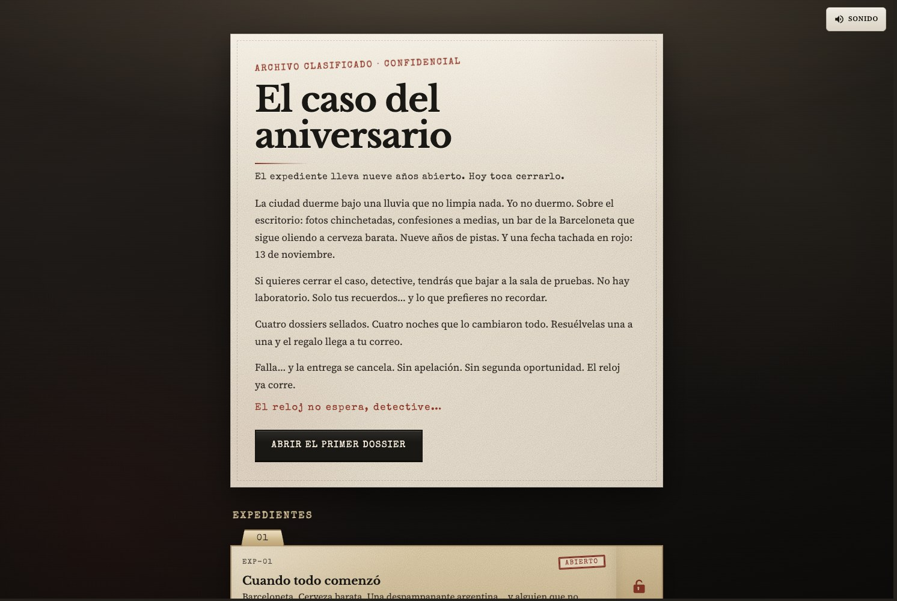

<p align="center">
  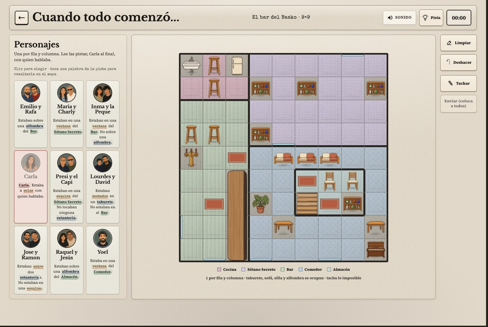
  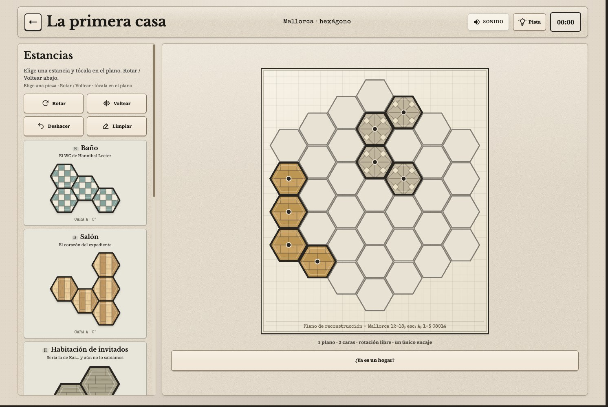
  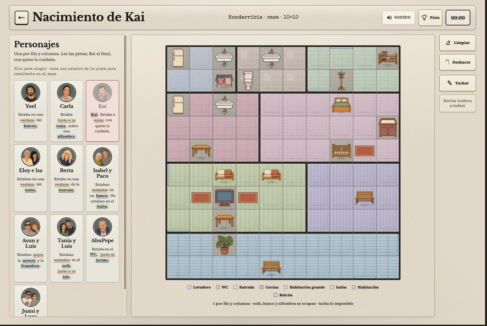
</p>
<p align="center">
  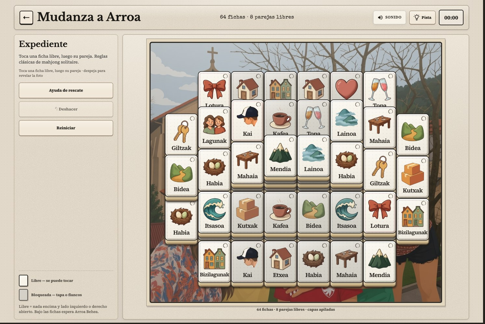
  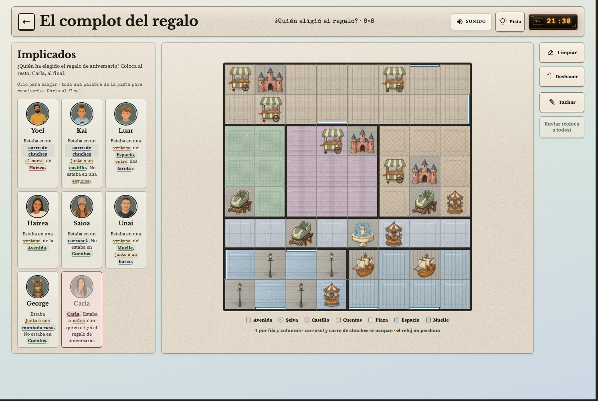
</p>

## Qué es

Una experiencia interactiva (React + TypeScript + Vite) pensada como regalo de aniversario: la detective abre dossiers, resuelve escenas del pasado compartido y, al cerrar el expediente, recibe la pieza que faltaba.

| Dossier | Título | Tipo (alto nivel) |
| ---: | --- | --- |
| 1 | Cuando todo comenzó | Lógica tipo murdoku |
| 2 | La primera casa | Puzzle hexagonal |
| 3 | Nacimiento de Kai | Lógica tipo murdoku |
| 4 | Mudanza a Arroa | Mahjong / matching |
| 5 | El complot del regalo | Revelación final (se desbloquea al completar los cuatro) |

El progreso se guarda automáticamente en el navegador. Tras cada dossier, el juego ofrece una **clave de guardado** para recuperar el avance en otro dispositivo o si se borran los datos.

## Estructura

```
app/                 Aplicación web (Vite)
  src/pages/         Landing e enrutado de retos
  src/puzzles/       Un directorio por dossier (+ shared/)
  src/lib/           Progreso, navegación, aviso final
  public/            Assets estáticos (fondos, finale…)
scripts/             Envío programado de la invitación
.github/workflows/   Cron del email del 13 de noviembre
```

## Desarrollo local

Requisitos: Node.js 20+ recomendado.

```bash
cd app
npm install
cp .env.example .env   # opcional: Apps Script para el email final
npm run dev
```

### Scripts (`app/`)

| Comando | Uso |
| --- | --- |
| `npm run dev` | Servidor de desarrollo |
| `npm run build` | Typecheck + build de producción |
| `npm run preview` | Sirve el build localmente |
| `npm run lint` | Oxlint |
| `npm run format` | Prettier |

## Emails (Google Apps Script)

Invitación (13 nov) y cierre del caso salen como **mail normal desde Gmail** (asunto, HTML “archivo clasificado”, nombre de remitente y adjunto de entradas en el cierre), vía un web app de Apps Script.

### Cierre del caso (dossier 5)

Al cerrar el caso (última pregunta), la app hace un `POST` al web app **una sola vez por navegador** (`localStorage`), con el adjunto `entradas-disney.jpg`.

En `app/.env` (y secrets de Pages):

```bash
VITE_GAS_WEBAPP_URL=https://script.google.com/macros/s/XXXX/exec
VITE_GAS_MAIL_SECRET=mismo-que-MAIL_SECRET-del-script
# Opcional — link Airbnb en el cuerpo del mail:
# VITE_AIRBNB_URL=https://www.airbnb.com/rooms/XXXX
```

Sin esas variables el juego funciona igual; el envío se omite.

La destinataria y un BCC opcional viven en **propiedades del script** (`RECIPIENT_EMAIL`, `BCC_EMAIL`), no en el cliente.

### Invitación (13 de noviembre)

Un GitHub Action hace `POST` el **13 de noviembre a las 09:00 UTC**.

**Idempotencia:** el cron es anual; el script solo envía si el año UTC es **2026**. 

1. Prueba: **Actions → Invite email (13 Nov) → Run workflow**.
2. Fuera de 2026: variable `FORCE_INVITE=1`.

Prueba local:

```bash
GAS_WEBAPP_URL=https://script.google.com/macros/s/XXXX/exec \
GAS_MAIL_SECRET=… \
SITE_URL=https://tu-dominio.com \
node scripts/send-invite-email.mjs
```

Ambos mails de prueba:

```bash
GAS_WEBAPP_URL=… GAS_MAIL_SECRET=… SITE_URL=… \
TEST_EMAIL_TO=tu@email.com \
node scripts/send-test-emails.mjs
```

## Despliegue (GitHub Pages)

El workflow [`.github/workflows/deploy-pages.yml`](./.github/workflows/deploy-pages.yml) construye `app/` y publica en Pages al hacer push a `aniversary` o `main`.

1. Repo → **Settings → Pages → Build and deployment → Source: GitHub Actions**.
2. (Opcional) Secrets `VITE_GAS_WEBAPP_URL`, `VITE_GAS_MAIL_SECRET`, `VITE_AIRBNB_URL`.
3. URL esperada: `https://yoelmartinfornieles.github.io/mision-aniversario/`
4. Pon esa URL (sin barra final) en el secret `SITE_URL` del workflow de invitación.

En CI el `base` de Vite es `/mision-aniversario/`; en local sigue siendo `/`.

## Privacidad

Repo pensado como proyecto personal / sorpresa. No publiques spoilers de claves de guardado ni el contenido del email final si la destinataria aún no ha jugado... Por favor!

## Evolución gráfica: antes y después

La renovación conserva la estética de expediente, el papel texturizado y los colores de las habitaciones. Cambia las ilustraciones y la interfaz para que los cinco dossiers compartan el mismo acabado.

- **Murdokus:** los símbolos SVG originales dejan paso a muebles ilustrados, con contornos marrones, colores cálidos y fondos transparentes. La barra se dibuja como una sola pieza continua; las baldas del bar contienen botellas.
- **Parque:** castillo, vagón de montaña rusa, carrito, carrusel, barco, fuente y farola comparten paleta y sombreado. Las siluetas se simplifican para reconocerse dentro de una casilla.
- **Hexágono:** frente a la primera versión plana, las estancias incorporan patrones de suelo y el tablero se presenta como un plano de reconstrucción. Los patrones ya existían antes del último commit gráfico; este termina de ajustar el marco, el pie y los controles.
- **Mahjong:** dibujos ilustrados, nombres en euskera más legibles, cantos de marfil y mayor profundidad entre capas. El tablero aprovecha el espacio disponible y diferencia la selección de la pareja de rescate.
- **Interfaz:** bordes y sombras más suaves, botones unificados, bombilla de trazo e iconos del hexágono más claros. Las herramientas del murdoku quedan agrupadas y los paneles laterales muestran su barra de desplazamiento en escritorio.
- **Móvil:** cabeceras con espacio para los controles y el reloj, sin comprimir sus cifras; el tablero queda antes que las pistas y herramientas.
- **Assets:** se retiran 88 fotografías y retratos sin uso de la versión distribuida. Los archivos anteriores siguen disponibles en el historial de Git.

Las capturas siguientes se han tomado a **1492 × 1000 píxeles**, con los tableros sin resolver. **Antes** corresponde al commit `9666d29`, inmediatamente anterior a la renovación gráfica; ya incluye las mejoras de lógica y textos. La excepción es el **dossier 02**: su captura procede de la revisión histórica `e56c240341b3c59b25b9fcf722e87adcc0859da5`, anterior a los patrones de suelo, para mostrar su acabado plano original. **Después** muestra la versión ilustrada actual. Los tiempos y las orientaciones iniciales pueden variar entre versiones.

| Dossier | Antes | Después |
| --- | --- | --- |
| 01 · El bar | [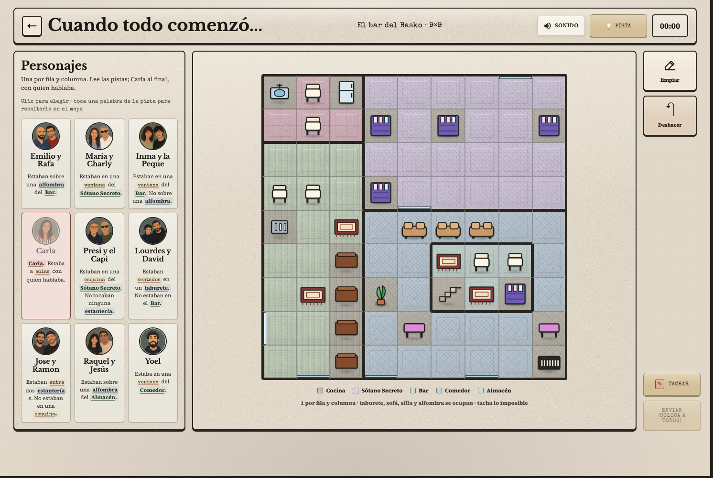](docs/screenshots/before/02-murdoku.jpg) | [](docs/screenshots/02-murdoku.jpg) |
| 02 · La primera casa | [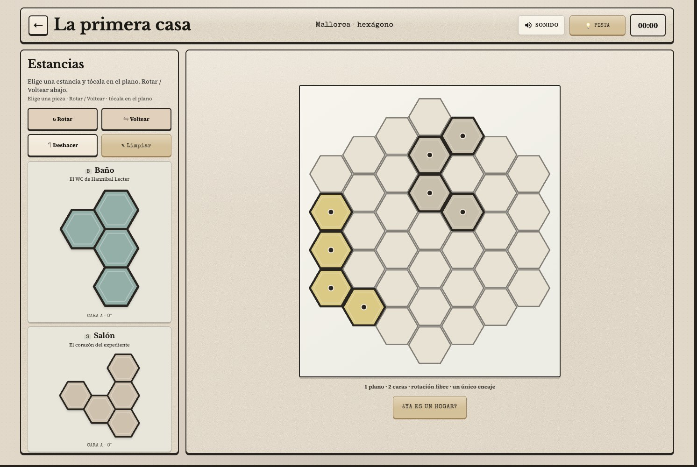](docs/screenshots/before/03-hexagon.jpg) | [](docs/screenshots/03-hexagon.jpg) |
| 03 · Nacimiento de Kai | [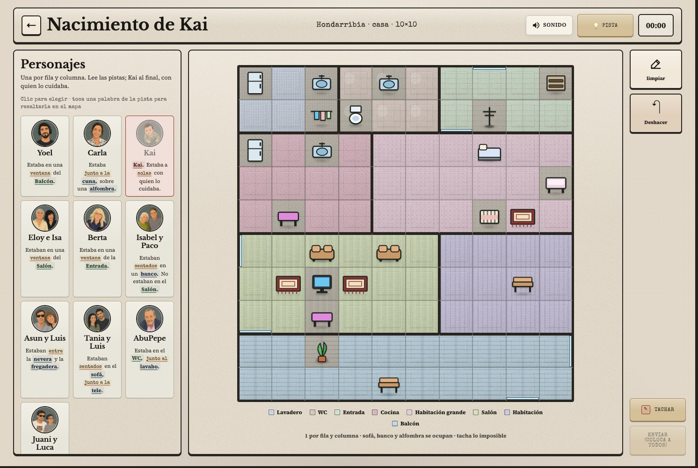](docs/screenshots/before/05-kai.jpg) | [](docs/screenshots/05-kai.jpg) |
| 04 · Arroa | [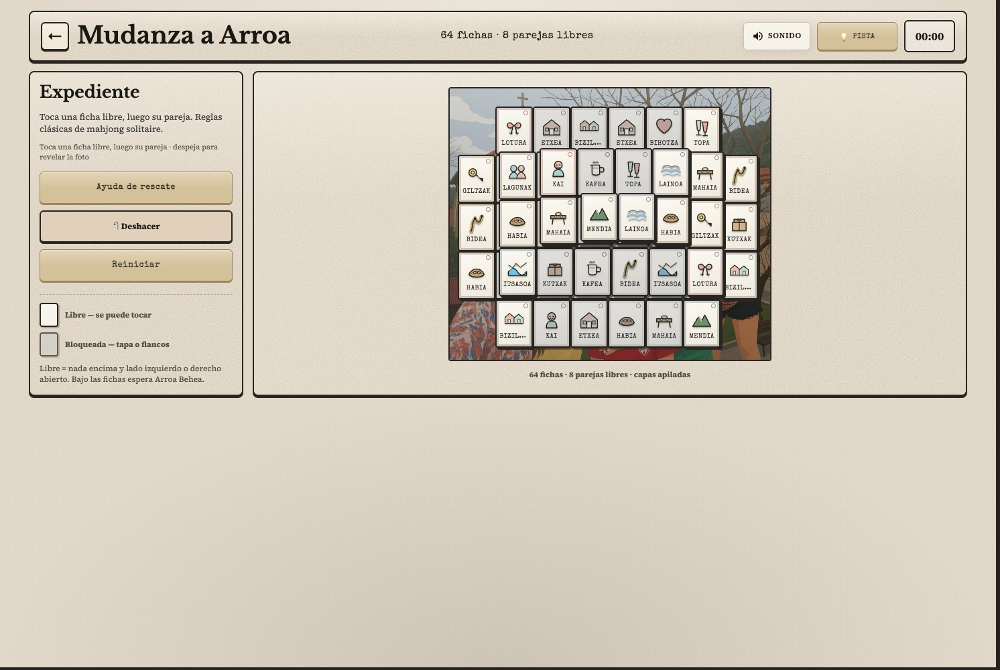](docs/screenshots/before/04-mahjong.jpg) | [](docs/screenshots/04-mahjong.jpg) |
| 05 · El parque | [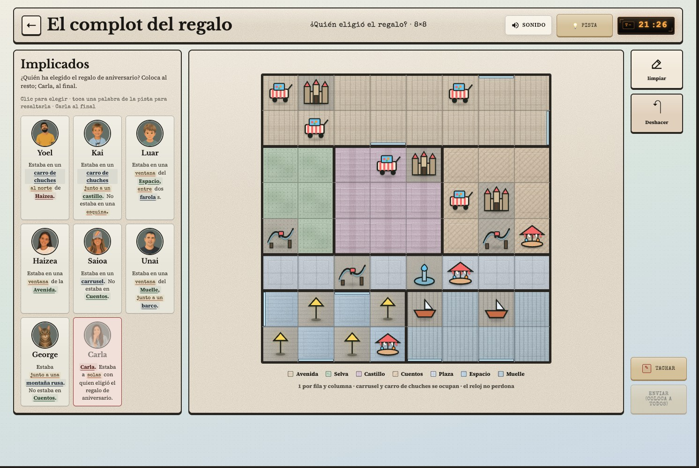](docs/screenshots/before/06-park.jpg) | [](docs/screenshots/06-park.jpg) |

Pulsa cualquier imagen para verla a tamaño completo.
